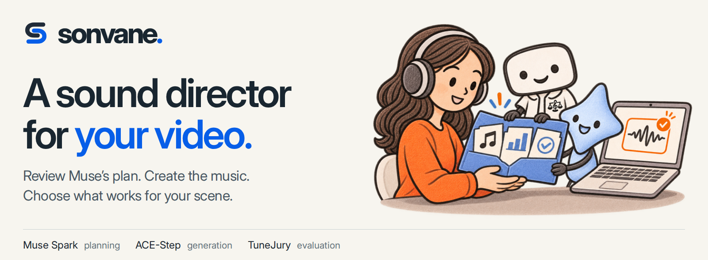
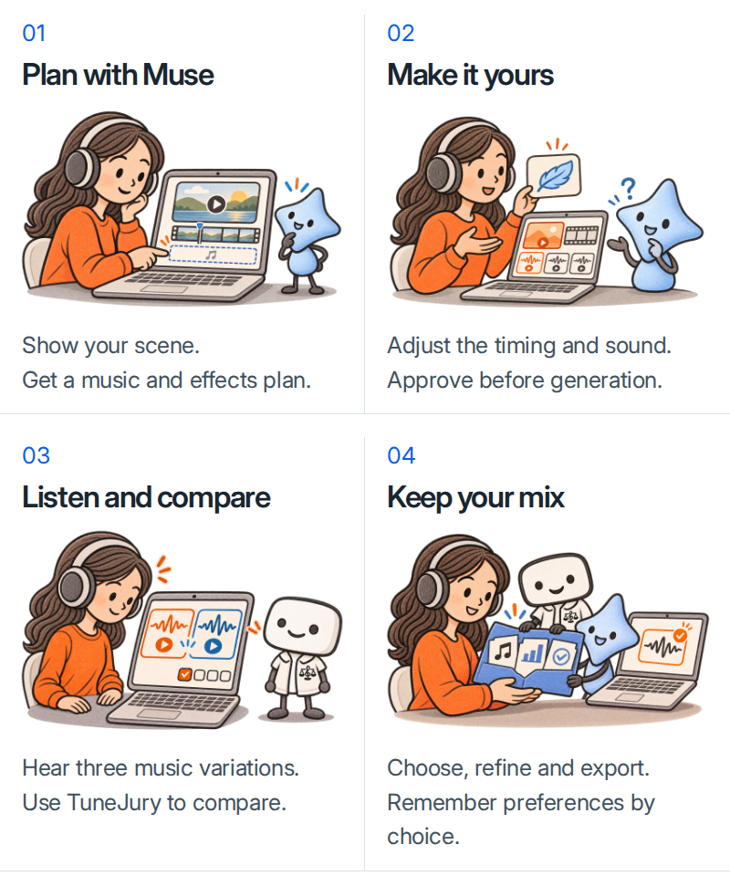

<p align="center">
  <a href="https://yonghyunk1m-sonvane.hf.space/demo/"></a>
  <a href="https://yonghyunk1m-sonvane.hf.space/demo/film.html"></a>
  <a href="app/static/report/sonvane-technical-report.pdf"></a>
  <a href="docs/user-guide.md"></a>
  <a href="docs/CHANGELOG.md"></a>
</p>

<p align="center"><sub>Built by Yonghyun Kim for the <a href="https://cerebralvalley.ai/e/meta-ai-developer-hackathon">Meta Global AI Developer Hackathon</a>.</sub></p>

> **Sonvane brings sound planning, music generation, comparison, and personalized recommendations into one workflow, where you approve the plan and choose the final soundtrack.**

https://github.com/user-attachments/assets/0b8d914d-f53c-43c5-8219-e8e672d62d65

[Watch the full demo on Hugging Face →](https://yonghyunk1m-sonvane.hf.space/demo/film.html)

## Choose how your video sounds

**“Let the scene breathe. Then bring in the music.”**

Start with your video and a direction. Muse reads the scene and available original audio, then suggests when music and effects should enter. Review the timing, change the sound, and approve the plan before generation.



**[ACE-Step](https://github.com/ace-step/ACE-Step-1.5)** creates the music; **[TuneJury](https://huggingface.co/TuneJury/tunejury)** helps evaluate it. Sonvane brings the plan, music and your listening choices together, with approval before generation and edits you can trace.

Compare at the same playback position, revise one passage, or share your chosen mix as an MP4 or a self-contained HTML video card. Remember a listening preference only when you want it used again. [How the complete pipeline works →](app/static/report/sonvane-technical-report.pdf)

## Run Sonvane

Requires **Python 3.12**, a **Meta Model API key**, and an **NVIDIA GPU** compatible with the generator’s CUDA 12.8 environment. Model installation downloads several GB.

```bash
git clone https://github.com/yonghyunk1m/sonvane.git
cd sonvane
python3.12 -m venv .venv
.venv/bin/python -m pip install -r requirements.txt
cp .env.example .env
```

Set `MODEL_API_KEY` in `.env`, then:

```bash
.venv/bin/python scripts/download_models.py
.venv/bin/python scripts/setup_generator.py --python python3.12
bash scripts/run.sh
```

Open the local app shown in the startup log, then choose **Studio**. [Setup, remote access and optional voice →](docs/user-guide.md)

**Availability:** the Hugging Face demo is accessible through its direct app URL. Studio runs on a connected GPU server; the demo film is hosted directly on Hugging Face and plays independently. See [deployment details](docs/huggingface-deployment.md) for hosting limits.

<details>
<summary><strong>Technical details & verification</strong></summary>

- **108 automated tests pass** (4 November 2026). Fixtures and mocked providers check execution behavior; they do not measure creative quality.
- **3–30-second working sections** from videos up to ten minutes. Interval repainting requires a 10–30-second track and a valid interval of at least one second.
- **Music-only evaluation:** silence gaps and synthesized effects are excluded. A1 measures model preference, not video fit or a rating out of ten.
- **Explicit personalization:** remembered A/B choices fit a separate, bounded linear ranker. Saved text directions separately inform Muse.
- **Scope:** local prototype; no controlled study yet establishes time savings or preference improvements. The Overview is an interactive artwork, separate from Studio’s generated music.

```bash
.venv/bin/python -m pip install -r requirements-dev.txt
.venv/bin/python -m pytest -q
```

[Technical report](app/static/report/sonvane-technical-report.pdf) · [HTML source](app/static/report/index.html) · [Recorded integration checks](docs/studio-verification.md) · [Model provenance](docs/THIRD_PARTY.md)

</details>

---

Original code: [MIT](LICENSE). Models, fonts and artwork retain their separate terms.

Created by **Yonghyun Kim (김용현)** · [yonghyunk1m.com](https://yonghyunk1m.com). Independent project built with existing models.

[Credits and upstream licenses](docs/THIRD_PARTY.md)
